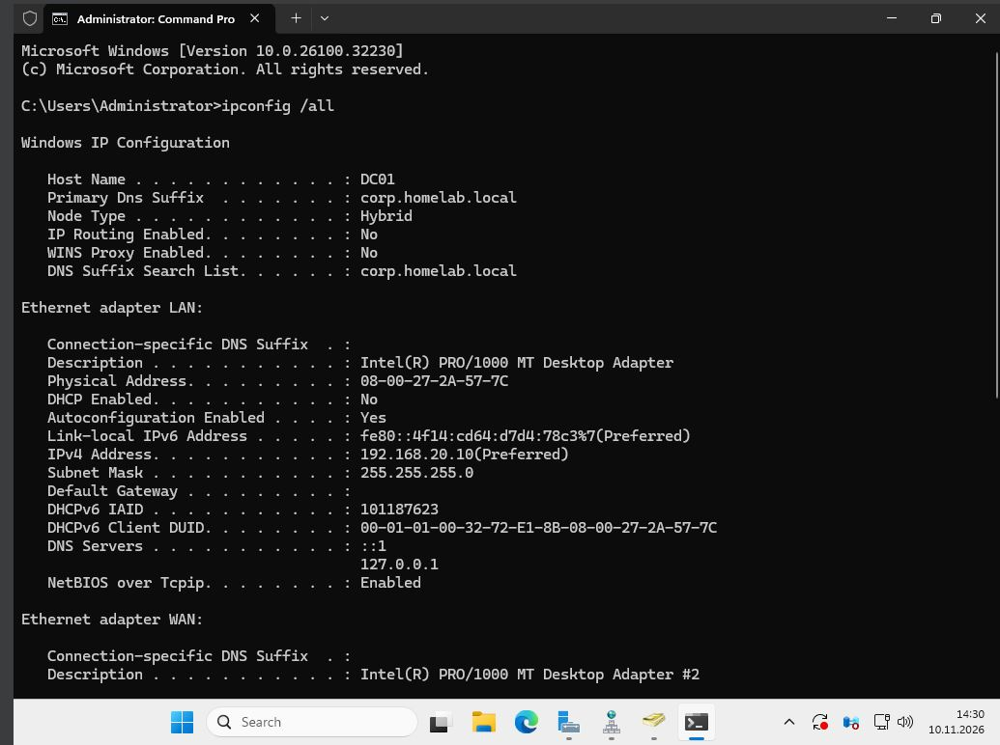

# 2. Active Directory and DNS Configuration

W ramach laboratorium zainstalowałem role Active Directory Domain Services (AD DS) oraz DNS na pierwszym serwerze (`DC01`), a następnie promowałem go do roli Kontrolera Domeny, tworząc nowy las i domenę `corp.homelab.local`. Zweryfikowałem poprawność utworzenia struktur bazy danych (`NTDS.dit`), udziałów sieciowych (`SYSVOL`, `NETLOGON`), kluczowych rekordów `SRV` w strefie DNS oraz końcowej konfiguracji sieciowej kontrolera.

---

## Przebieg konfiguracji i zrzuty ekranu

### 1. Instalacja ról Active Directory Domain Services (AD DS) oraz DNS
Dodanie wymaganych ról serwerowych wraz z narzędziami administracyjnymi na serwerze `DC01` za pomocą Server Managera.


### 2. Promocja serwera `DC01` do roli Kontrolera Domeny
Utworzenie nowego lasu Active Directory (`corp.homelab.local`), konfiguracja roli Global Catalog (GC), zintegrowanego serwera DNS oraz zdefiniowanie hasła trybu przywracania usług katalogowych (DSRM).


### 3. Weryfikacja konfiguracji sieciowej po promocji (`ipconfig`)
Potwierdzenie poprawności przypisania sufiksu domenowego oraz ustawień adresacji IPv4 i DNS po zakończeniu procesu promocji kontrolera domeny.



---

## Użyte polecenia (PowerShell / CMD)

```powershell
# Sprawdzenie konfiguracji sieciowej i sufiksu DNS
ipconfig /all

# Sprawdzenie udostępnionych zasobów domenowych (SYSVOL i NETLOGON)
net share

# Weryfikacja podstawowych usług Active Directory i DNS
Get-Service NTDS, DNS, Netlogon, W32Time

# Test rozwiązywania nazw i rekordów domeny
nslookup corp.homelab.local
